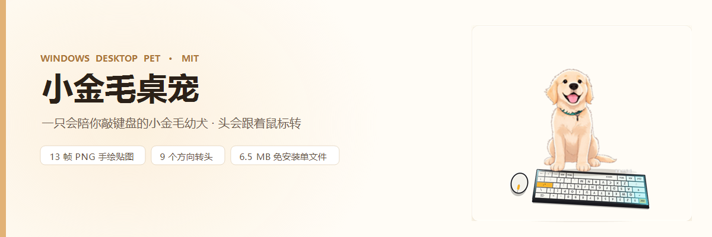
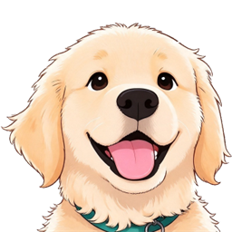
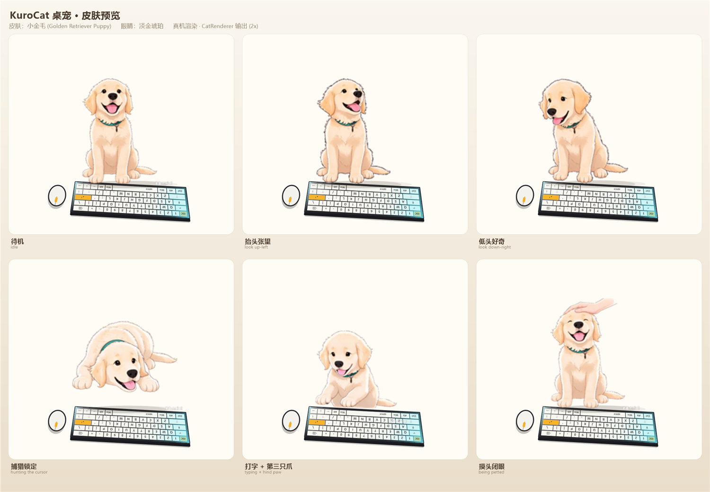
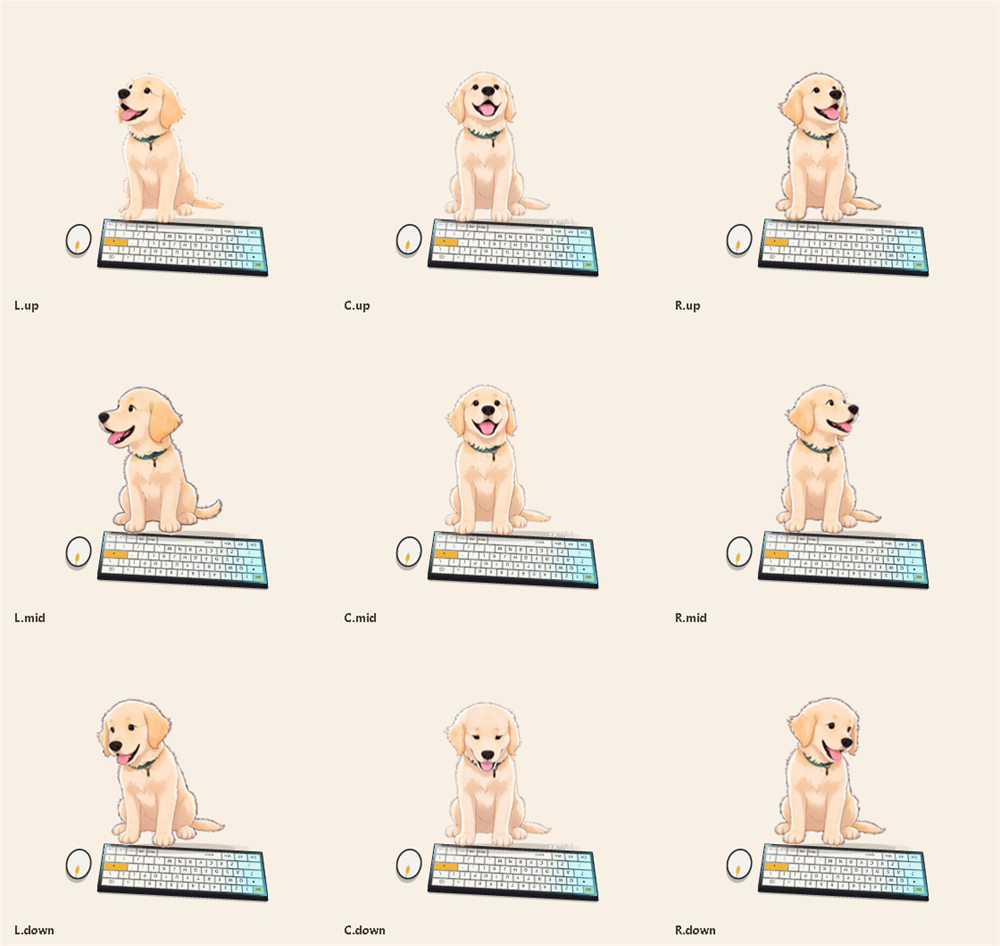

<div align="center">



# Golden Puppy Desktop Pet

**A golden retriever puppy that lives on your Windows desktop: it sits on a keyboard, types along with you, and turns its head toward your cursor.**

[](https://github.com/Kreston8/KuroCat-Puppy/releases/latest)
[](#download)
[](LICENSE)

[Download](#download) · [Screenshots](#screenshots) · [Features](#features) · [Build](#build-from-source)

</div>

---

[中文说明](README.md)

## What is this

A fork of [chanke17/KuroCat](https://github.com/chanke17/KuroCat) that replaces the vector-drawn cat with a **golden retriever puppy**.

The work is in the Windows renderer: the skin went from "shapes drawn in code" to **13 PNG sprite frames** compiled straight into the executable — you download one file and run it, no external assets.

<div align="center"></div>

## Screenshots

### Six poses

<p align="center"></p>

> Idle · look up · look down · hunt · typing · head pat. Everything is rendered live on a 360×320 transparent overlay; the keyboard under its paws is drawn by the app and its keycaps light up with the animation.

### Head follows the cursor (9 directions)

<p align="center"></p>

> Left / centre / right × up / middle / down. The head looks wherever the cursor is.
> Direction switching uses an enter/exit hysteresis (0.22 in, 0.10 out), so the head does not jitter when the cursor sits on a boundary angle.

## Features

- **13 hand-drawn PNG frames**: 7 poses (idle / look up / look down / happy / hunt / typing / blink) plus 6 left-right gaze frames, all stored as RCDATA in the exe.
- **9-direction gaze** driven by the cursor, with hysteresis and graceful fallback when a frame is missing.
- **Clean transitions**: latest frame hard-selected with a 170 ms cross-fade of the previous one.
- **Typing alignment**: the typing pose is shifted 21 px down onto the keycaps and skips the ground shadow (otherwise it leaves a grey smudge on the keys).
- **Automatic background removal**: white-background art is flood-filled (keeping eye whites and highlights), transparent art is scaled by foot landmarks.
- **Upstream features kept**: the original four cat coats (vector rendered, switchable from the tray menu), bounce physics, edge snapping, tray menu and tray icon.
- **Single portable exe**: about 6.5 MB, no installer, no runtime.

## Download

1. Open [**Releases**](https://github.com/Kreston8/KuroCat-Puppy/releases/latest)
2. Download `小金毛桌宠.exe` (the filename is Chinese; the app itself is portable)
3. Run it. Windows 10 / 11 x64, no install, no redistributables.

> If Explorer shows a generic icon, that is the icon cache — press <kbd>F5</kbd> or restart Explorer.

## Build from source

Requires Visual Studio Build Tools (MSVC, C++17).

```bat
cd windows
build.bat
```

`build.bat` will:

1. compile `skin\puppy_skin.rc` (13 PNGs + icon) into `puppy.res` with `rc`
2. statically link `windows\KuroCat.exe` with `cl` (`/MT`, no external dependencies)

Equivalent manual command line:

```bat
rc /nologo /c 65001 /fo puppy.res skin\puppy_skin.rc

cl /nologo /std:c++17 /O2 /MT /EHsc /utf-8 /DUNICODE /D_UNICODE ^
   src\main.cpp puppy.res /Fe:KuroCat.exe ^
   /link /SUBSYSTEM:WINDOWS,6.01 /MANIFEST:EMBED /MANIFESTINPUT:app.manifest ^
   user32.lib gdi32.lib gdiplus.lib shell32.lib advapi32.lib winhttp.lib wtsapi32.lib shlwapi.lib ole32.lib
```

## Sprite specification

To swap in another dog, replace the images under `windows/skin/` keeping the file names:

| Resource ID | File | State | Note |
| --- | --- | --- | --- |
| 101 | `idle.png` | idle | master frame, **all other frames align to it** |
| 102 | `look_up.png` | look up | cursor above the pet |
| 103 | `look_down.png` | look down | cursor below the pet |
| 104 | `happy.png` | head pat | played when petted |
| 105 | `hunt.png` | hunt | pounce |
| 106 | `type.png` | typing | shifted 21 px down onto the keycaps |
| 107 | `blink.png` | blink | inserted at random |
| 108–110 | `gaze_l_up/mid/down.png` | looking left, up/mid/down | cursor on the left |
| 111–113 | `gaze_r_up/mid/down.png` | looking right, up/mid/down | cursor on the right |

Art requirements:

- **Canvas**: any size, white or transparent background; background removal and foot-landmark scaling are automatic.
- **Composition**: use `idle.png` as the reference — same dog, same camera, feet at the same spot near the bottom edge.
- **Margins**: keep the subject away from the edges, especially above the head (frames with a raised paw or a pat need more room).
- **Alignment**: transparent art is aligned to `idle` by "centroid x of the bottom 6 % band + bbox bottom edge".

## Layout

```
windows/
  src/            C++17 renderer and physics
    main.cpp          window, tray, hotkeys
    CatRenderer.hpp   scene drawing (incl. keyboard)
    CatPhysics.hpp    physics and coat parameters
    PuppySkin.hpp     PNG sprite skin (load/align/gaze/fade)
    PuppySkinRes.h    resource IDs
  skin/           art and resource script
    *.png             13 sprite frames
    puppy_head.ico    application icon
    puppy_skin.rc     resource script
  tools/preview/  preview tool: renders all states into a contact-sheet PNG
  build.bat       build script
docs/             images used by the README
```

## Credits and license

- Upstream: [**chanke17/KuroCat**](https://github.com/chanke17/KuroCat) — the desktop pet itself (physics, render framework, cat coats, tray logic) comes from upstream under the MIT license.
- Puppy artwork: provided by the author of this repository and arranged into sprite frames following the specification above.
- This repository is released under the same [MIT](LICENSE) license, keeping the upstream copyright notice.

## Known issues

- In `happy.png` (head pat) the hand is **already cut off at the top of the source image**, so the arm edge is slightly hard. The app fades the top 26 rows to soften it; a clean fix needs a re-export of that frame.
