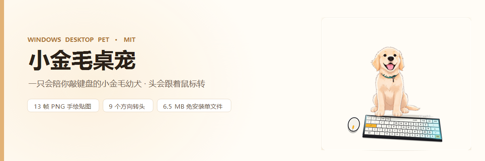
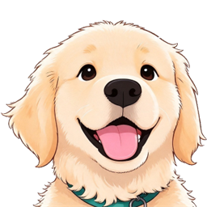
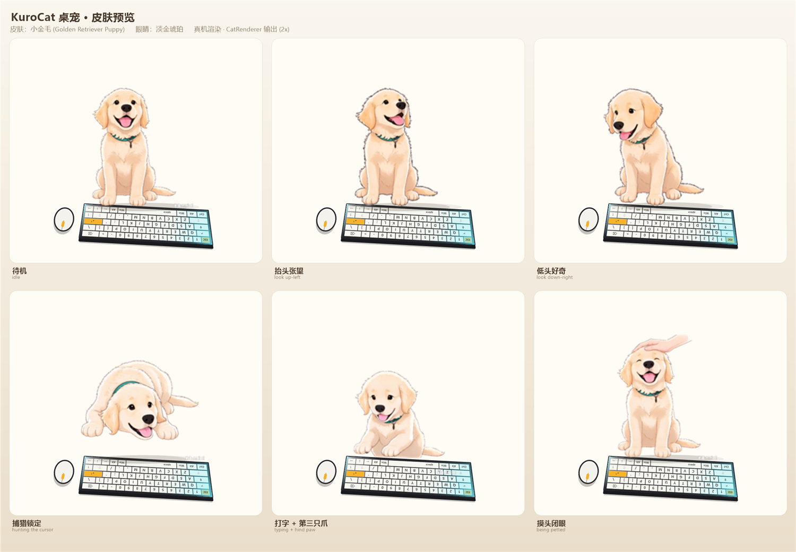
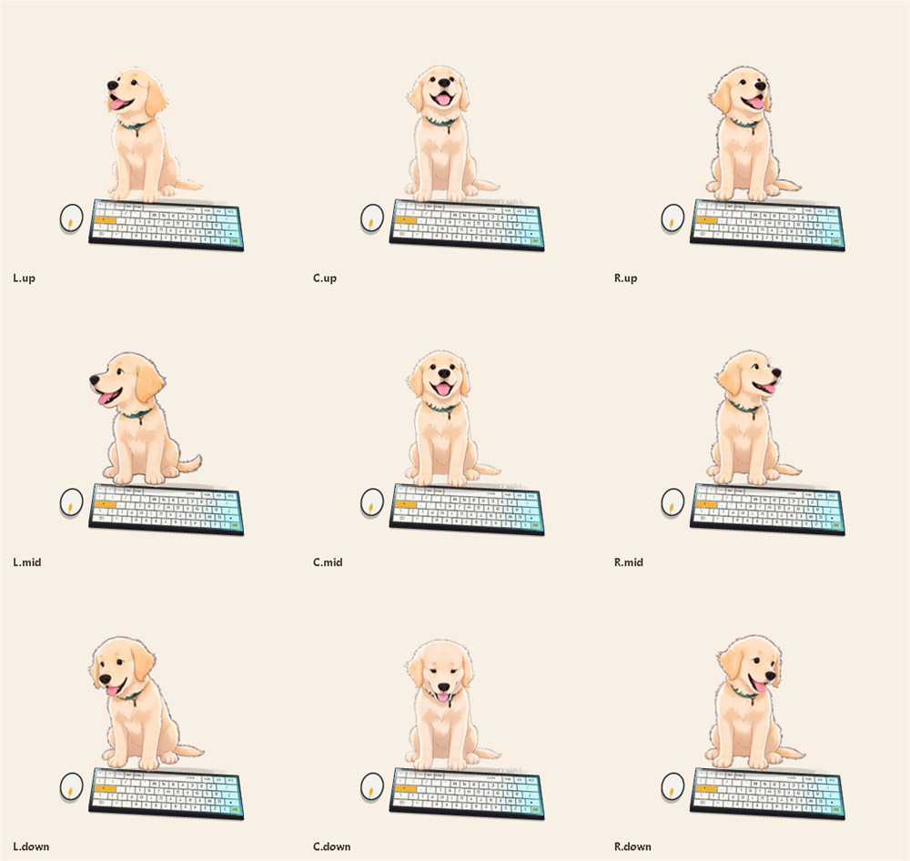

<div align="center">



# 小金毛桌宠

**一只住在你 Windows 桌面上的小金毛幼犬：坐在键盘上陪打字，头会跟着鼠标转。**

[](https://github.com/Kreston8/KuroCat-Puppy/releases/latest)
[](#下载)
[](LICENSE)

[下载](#下载) · [效果](#效果展示) · [功能](#功能) · [构建](#从源码构建) · [换素材](#素材规格) · [致谢](#致谢与许可)

</div>

---

## 它是什么

这是 [chanke17/KuroCat](https://github.com/chanke17/KuroCat) 的一个改造分支：把原本矢量绘制的那只猫，换成了**小金毛幼犬**。

改动集中在 Windows 版渲染层——皮肤从"代码画出来的矢量图形"改成**13 张 PNG 序列帧贴图**，直接编进 exe，所以下载单个文件就能跑，不依赖任何外部图片。

<div align="center"></div>

## 效果展示

### 六种姿态

<p align="center"></p>

> 待机 · 抬头 · 低头 · 捕猎 · 打字 · 摸头。全部由程序实时渲染在 360×320 的透明浮层上，脚下的键盘是画出来的，键帽会随动作高亮。

### 头会跟着鼠标转（9 个方向）

<p align="center"></p>

> 左 / 中 / 右 × 上 / 中 / 下，共 9 个朝向。鼠标在哪个方向，小狗的头就朝哪个方向看。
> 切换用"进得快、退得慢"的迟滞阈值（进入 0.22 / 退出 0.10），所以光标停在临界角度上不会来回抖。

## 功能

- **13 张 PNG 手绘贴图**：7 类姿态帧（待机 / 抬头 / 低头 / 开心 / 捕猎 / 打字 / 眨眼）+ 6 张左右转头帧，全部编进 exe 的 RCDATA 资源。
- **9 方向注视**：鼠标位置驱动转头，带迟滞防抖；缺帧时自动回退到相邻方向，不会突然"跳帧"。
- **帧间过渡**：最近帧硬切换 + 前一张 170ms 交叉淡出，动作干净不糊。
- **打字对齐**：打字姿态单独下沉 21px 贴到键帽上，且该姿态不画地面阴影（否则键帽上会留一圈灰印）。
- **自动抠底**：白底素材走 flood-fill 去底（保住眼白和高光），透明素材按脚部地标等比缩放对齐。
- **原有特性保留**：4 套猫皮肤（矢量渲染，托盘菜单可切换）、物理回弹、贴边、托盘菜单与托盘图标。
- **单文件免安装**：一个 exe，约 6.5 MB，绿色运行。

## 下载

1. 打开 [**Releases**](https://github.com/Kreston8/KuroCat-Puppy/releases/latest)
2. 下载 `GoldenPuppy-DesktopPet-v1.0.1.exe`（就是"小金毛桌宠"本体，GitHub 只接受 ASCII 资产名，下载后想改名随意）
3. 双击运行。Windows 10 / 11 x64，无需安装、无需运行库。

SHA256（可与 `Get-FileHash .\GoldenPuppy-DesktopPet-v1.0.1.exe -Algorithm SHA256` 对照）：

```
AF384DCFB68F1F842021E63B7D768A5553C87DA56C568EEA6D1C3FB30A77F4FD
```

> 首次运行时 Windows 可能弹 SmartScreen（exe 未做代码签名），点"更多信息 → 仍要运行"。
>
> 若桌面图标显示成通用图标，是资源管理器的图标缓存，按 <kbd>F5</kbd> 刷新即可。

## 从源码构建

需要 Visual Studio Build Tools（MSVC，C++17）。

```bat
cd windows
build.bat
```

`build.bat` 会自动：

1. 用 `rc` 把 `skin\puppy_skin.rc`（13 张 PNG + 图标）编译成 `puppy.res`
2. 用 `cl` 静态链接出 `windows\KuroCat.exe`（/MT，无外部依赖）

手动构建等价写法：

```bat
rc /nologo /c 65001 /fo puppy.res skin\puppy_skin.rc

cl /nologo /std:c++17 /O2 /MT /EHsc /utf-8 /DUNICODE /D_UNICODE ^
   src\main.cpp puppy.res /Fe:KuroCat.exe ^
   /link /SUBSYSTEM:WINDOWS,6.01 /MANIFEST:EMBED /MANIFESTINPUT:app.manifest ^
   user32.lib gdi32.lib gdiplus.lib shell32.lib advapi32.lib winhttp.lib wtsapi32.lib shlwapi.lib ole32.lib
```

## 素材规格

想换成别的狗狗，只要替换 `windows/skin/` 下的图片并保持文件名不变：

| 资源 ID | 文件 | 状态 | 备注 |
| --- | --- | --- | --- |
| 101 | `idle.png` | 待机 | 主帧，**其它帧以它为基准对齐** |
| 102 | `look_up.png` | 抬头 | 光标在宠物上方 |
| 103 | `look_down.png` | 低头 | 光标在宠物下方 |
| 104 | `happy.png` | 摸头 | 被摸头时播放 |
| 105 | `hunt.png` | 捕猎 | 前扑 |
| 106 | `type.png` | 打字 | 会下沉 21px 贴到键帽 |
| 107 | `blink.png` | 眨眼 | 随机插入 |
| 108–110 | `gaze_l_up/mid/down.png` | 朝左看上/中/下 | 光标在左侧 |
| 111–113 | `gaze_r_up/mid/down.png` | 朝右看上/中/下 | 光标在右侧 |

素材要求：

- **画布**：任意尺寸，白底或透明底都行；程序会自动抠底并按脚部地标缩放到统一基准。
- **构图**：以 `idle.png` 为基准——同一只狗、同一机位、脚踩在画面底部同一位置。
- **留白**：主体四周别贴边，尤其头顶上方留出空间（有抬爪、被摸头动作的帧要留更多）。
- **对齐**：透明底素材按"底部 6% 条带的质心 x + bbox 底边"对齐到 `idle` 的脚部位置。

## 目录结构

```
windows/
  src/            C++17 渲染器与物理
    main.cpp          窗口、托盘、快捷键
    CatRenderer.hpp   场景绘制（含键盘）
    CatPhysics.hpp    物理与皮肤参数
    PuppySkin.hpp     PNG 序列帧皮肤（加载/对齐/朝向/淡入淡出）
    PuppySkinRes.h    资源 ID 定义
  skin/           贴图与资源脚本
    *.png             13 张贴图
    puppy_head.ico    应用图标
    puppy_skin.rc     资源脚本
  tools/preview/  预览工具：把各状态渲染成联系表 PNG
  build.bat       构建脚本
docs/             README 配图
```

## 致谢与许可

- 上游项目：[**chanke17/KuroCat**](https://github.com/chanke17/KuroCat) — 桌面宠物本体（物理、渲染框架、猫皮肤、托盘逻辑）来自上游，MIT 许可。
- 小金毛贴图：由本仓库作者提供并按上面的规格整理成序列帧。
- 本仓库同样以 [MIT](LICENSE) 发布，保留上游版权声明。

## 已知问题

- `happy.png`（摸头）素材里那只手在**源图顶端就被截断**了，画面上手臂边缘会有一点硬切。程序在顶部做了 26 行的淡出缓解，彻底修复需要重导该素材。
